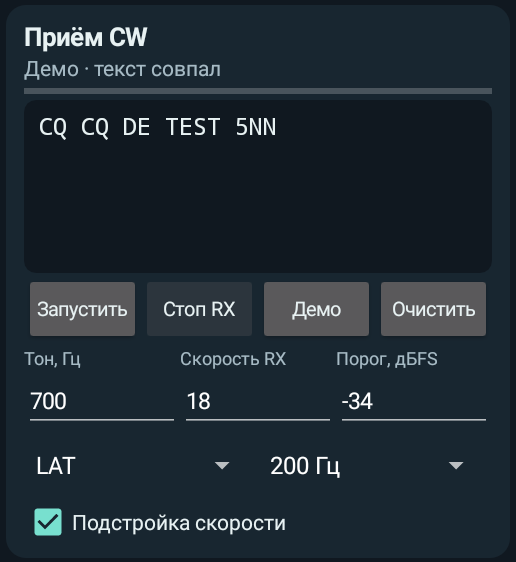

# CW Mobile

[Русский](#русский) · [English](#english)

## Русский

**CW Mobile** — приложение для приёма, декодирования и ручной передачи азбуки Морзе на Android 8.0+. Работает офлайн. Поддерживает LAT и RUS, подстройку скорости WPM, фильтры 100/200/300/500 Гц, редактируемые макросы и деморежим без трансивера.

### Трансиверы

| Профиль | CAT через USB OTG | Передача |
| --- | --- | --- |
| Xiegu G90 | CI-V через DE-19, 19200 8N1, адрес `70` | USB-аудиотон и PTT по CAT, U-D |
| Icom IC-7300 | CI-V, 19200 8N1, адрес `94` | USB-аудиотон и PTT по CAT, USB-D, DATA MOD = USB |
| Yaesu FT-991A | ASCII, порт Enhanced, 38400 8N2 | USB-аудиотон и PTT по CAT, DATA-USB |
| Kenwood TS-590SG | ASCII, 115200 8N1 | USB-аудиотон и CAT DATA SEND, USB-DATA |
| Wolf 2 | TS-2000, CAT/CW USB CDC, 115200 8N1 | Аппаратное CW, DTR = ключ, RTS = PTT |
| Только аудио (RX) | — | Приём через USB-аудиовход или микрофон |

Указаны начальные параметры. Сверьте их с меню радио. CAT-порт, аудиовход и аудиовыход выбираются отдельно в разделе **Оборудование**. Нажмите **Демо** в разделе **Приём CW**, чтобы проверить декодер без радиостанции.

- [Руководство пользователя со скриншотами (PDF)](docs/CW_Mobile_User_Guide_RU.pdf)
- [Настройки подключения для каждой модели](docs/connection-ru.md)

APK запускался в эмуляторе Android. Пять профилей проверены на имитации обмена CAT. Работа USB-аудио, ключевания и передачи на физической аппаратуре требует проверки. При первом тесте TX используйте эквивалент нагрузки и низкую мощность.

### Сборка

Нужны Android SDK 35, Build Tools 35.0.0 и JDK 17 или 21. Выполните `./gradlew :app:assembleDebug` (Windows: `gradlew.bat :app:assembleDebug`). APK появится в `app/build/outputs/apk/debug/`. Команда `bash tests/run.sh` запускает проверки декодера и протоколов. Они также выполняются в GitHub Actions.

Версия 1.1.0 использует пакет `org.cwmobile` и устанавливается отдельно от G90 CW. Для публичного релиза подпишите APK своим ключом.

## English

**CW Mobile** is an offline Android 8.0+ app for receiving, decoding, and manually transmitting Morse code. It supports Latin and Cyrillic decoding, adaptive WPM, 100/200/300/500 Hz filters, editable CW macros, and a demo that runs without a radio.

### Radio profiles

| Profile | CAT over USB OTG | Transmission |
| --- | --- | --- |
| Xiegu G90 | CI-V through DE-19, 19200 8N1, address `70` | USB audio tone and CAT PTT, U-D |
| Icom IC-7300 | CI-V, 19200 8N1, address `94` | USB audio tone and CAT PTT, USB-D, DATA MOD = USB |
| Yaesu FT-991A | ASCII, Enhanced port, 38400 8N2 | USB audio tone and CAT PTT, DATA-USB |
| Kenwood TS-590SG | ASCII, 115200 8N1 | USB audio tone and CAT DATA SEND, USB-DATA |
| Wolf 2 | TS-2000, CAT/CW USB CDC, 115200 8N1 | Hardware CW, DTR = key, RTS = PTT |
| Audio only (RX) | — | Receive from USB audio or the phone microphone |

The listed values are starting points. Match the radio's settings. Select the radio, CAT port, RX input and TX output independently under **Оборудование** (Equipment). In **Приём CW** (CW Receive), tap **Демо** (Demo) to test the decoder without a radio. The app UI is in Russian.

- [Illustrated user guide (PDF, Russian)](docs/CW_Mobile_User_Guide_RU.pdf)
- [Model-specific wiring and configuration (Russian)](docs/connection-ru.md)

The APK was run in an Android emulator. Five CAT profiles were tested against simulated replies. USB audio, hardware keying, and RF transmission still require testing with physical radios. For the first TX test, use a dummy load and low radio power.

### Build

Use Android SDK 35, Build Tools 35.0.0, and JDK 17 or 21. Run `./gradlew :app:assembleDebug` (Windows: `gradlew.bat :app:assembleDebug`). The APK is written to `app/build/outputs/apk/debug/`. Run `bash tests/run.sh` for decoder and protocol checks. GitHub Actions runs the same checks.

Version 1.1.0 uses package ID `org.cwmobile` and installs alongside G90 CW. Sign public release APKs with your own release key.

## Лицензия и источники / License and references

Проект распространяется по лицензии [MIT](LICENSE). Отдельная [лицензия USB Serial](LICENSE-usb-serial-for-android.txt) включена в репозиторий. При разработке использованы подходы [FT8CN](https://github.com/N0BOY/FT8CN) и [WSJT-X](https://wsjt.sourceforge.io/wsjtx-doc/wsjtx-main.html), а [Hamlib](https://github.com/Hamlib/Hamlib) и руководства производителей помогли сверить протоколы.

This project is licensed under [MIT](LICENSE). The [USB Serial license](LICENSE-usb-serial-for-android.txt) is included separately. The design draws on [FT8CN](https://github.com/N0BOY/FT8CN) and [WSJT-X](https://wsjt.sourceforge.io/wsjtx-doc/wsjtx-main.html). CAT behavior was cross-checked against [Hamlib](https://github.com/Hamlib/Hamlib) and radio manuals.
